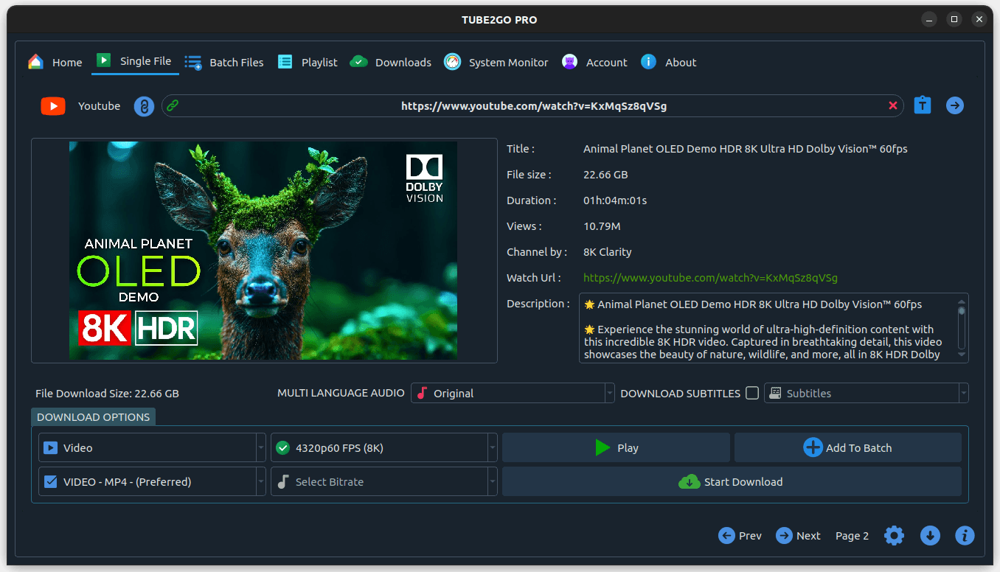
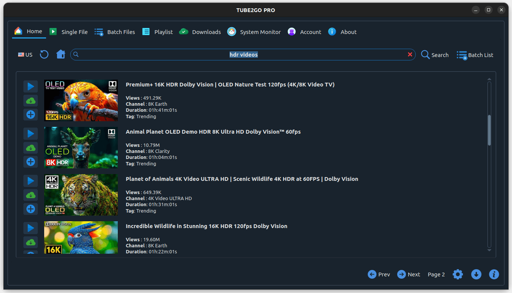
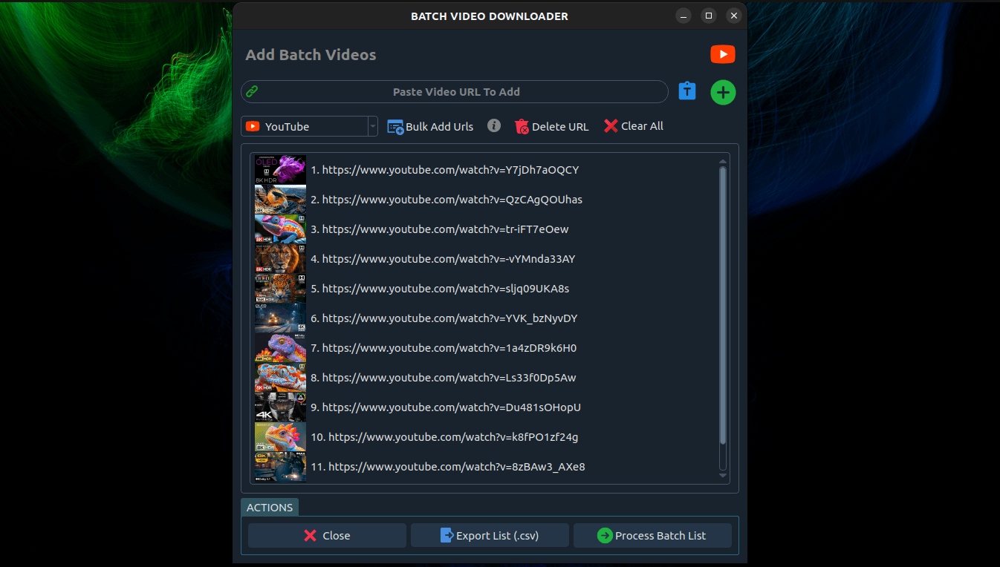
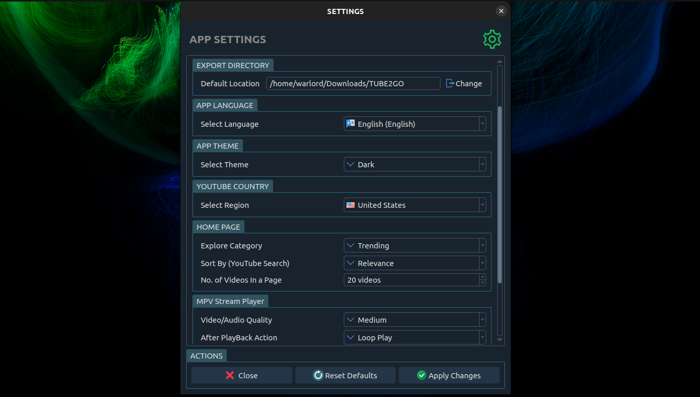
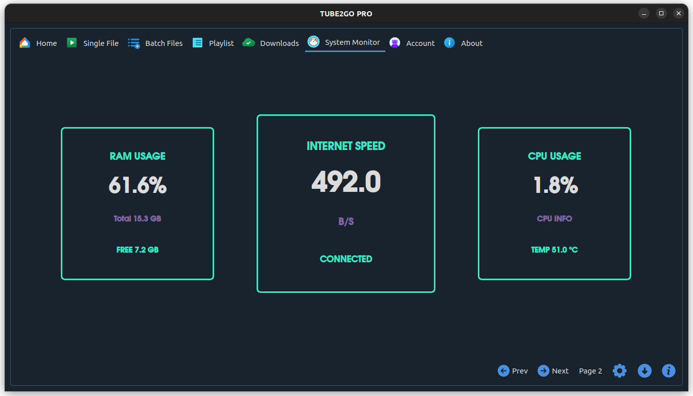

# TUBE2GO — One-Click YouTube Downloader for Linux and Windows

**TUBE2GO is a straightforward desktop YouTube downloader for Linux and Windows.** Save videos, playlists and music in HD or as MP3 with a single click — plus subtitles, dubbed audio tracks, batch queues and a **built-in system monitor** that shows live network speed, CPU and memory while a long download runs. Available in 35+ languages.

<p align="center">
  
</p>

<p align="center">
  <a href="https://flathub.org/apps/details/com.warlordsoftwares.tube2go"></a>
  <a href="https://snapcraft.io/tube2go"></a>
  <a href="https://gitlab.com/WarlordSoftwares/tube2go/-/releases"></a>
</p>

<p align="center">
  
  
  
  
</p>

> **Installed 100,000+ times on Flathub.**

---

## Contents

- [Download and install](#-download-and-install)
- [Features](#-features)
- [What you can download](#-what-you-can-download)
- [Screenshots](#-screenshots)
- [Which downloader should I use?](#-which-downloader-should-i-use)
- [System requirements](#-system-requirements)
- [FAQ](#-faq)
- [Responsible use](#-responsible-use)
- [More apps](#-more-apps-by-warlord-softwares)

---

## 📥 Download and install

<p align="center">
  <a href="https://snapcraft.io/tube2go"></a>&nbsp;
  <a href="https://flathub.org/apps/details/com.warlordsoftwares.tube2go"></a>&nbsp;
  <a href="https://gitlab.com/WarlordSoftwares/tube2go/-/releases"></a>&nbsp;
  <a href="https://gitlab.com/WarlordSoftwares/tube2go/-/releases"></a>
</p>

### Linux — Snap

```bash
sudo snap install tube2go
```

### Linux — Flatpak

```bash
flatpak install flathub com.warlordsoftwares.tube2go
```

### Linux — AppImage (any distribution)

Download the latest `.AppImage` from the [releases page](https://gitlab.com/WarlordSoftwares/tube2go/-/releases), then:

```bash
chmod +x tube2go-x86_64.AppImage
./tube2go-x86_64.AppImage
```

### Windows

Download the Windows installer from the [releases page](https://gitlab.com/WarlordSoftwares/tube2go/-/releases) and run it. Windows 10 and 11 (64-bit).

---

## 🌟 Features

- **One-click downloads** — paste a link, pick a format, done. MP4, WEBM or MKV.
- **Whole playlists** — queue an entire YouTube playlist in a single action.
- **YouTube to MP3** — extract high-bitrate audio for offline listening.
- **Built-in system monitor** — live RAM usage, CPU load and temperature, and current network speed, so you can see what a long queue is costing your machine.
- **Batch downloading** — queue many videos and let them run back to back.
- **Multi-language audio tracks** — choose the dubbed track instead of the default.
- **Subtitles and closed captions** — save CC tracks alongside the video.
- **In-app YouTube search** — find and queue videos with region-specific results.
- **Ad-free streaming** — preview a video in the app before saving it.
- **Other platforms** — Facebook, Instagram, TikTok, X (Twitter), Rumble and more.
- **35+ interface languages.**
- **No ads, no trackers, no bundled installers.**

---

## 🎯 What you can download

| Task | Result |
|---|---|
| **Download a YouTube video** | MP4 or WEBM at your chosen quality |
| **Download a YouTube playlist** | Every video queued automatically |
| **Convert YouTube to MP3** | Audio-only extraction at high bitrate |
| **Download YouTube music** | Audio tracks saved for offline listening |
| **Download with subtitles** | Closed captions saved with the video |
| **Download a dubbed audio track** | Pick from the alternate language tracks |
| **Batch download many links** | Paste a list and let the queue run |
| **Watch resource usage** | Live RAM, CPU and network speed while downloading |

---

## 📸 Screenshots

| Video download | In-app YouTube search |
|---|---|
|  |  |

| Batch queue | Settings |
|---|---|
|  |  |

**Built-in system monitor** — RAM usage, live internet speed, CPU load and temperature while your queue runs:



---

## 🤔 Which downloader should I use?

Three of these apps download video, and they are aimed at different things:

| If you want... | Use |
|---|---|
| A simple one-click downloader, plus resource monitoring | **TUBE2GO** (this app) |
| Maximum resolution — 4K and 8K — and playlist depth | **[4KTUBE](https://gitlab.com/WarlordSoftwares/4ktube)** |
| The widest site coverage, 1400+ sites beyond YouTube | **[DL-YouTube](https://gitlab.com/WarlordSoftwares/youtube-dl-pro)** |

---

## 💻 System requirements

| | Minimum |
|---|---|
| **Linux** | Ubuntu 20.04+, Debian 11+, Fedora 36+, Arch, or any distro running Flatpak / Snap / AppImage |
| **Windows** | Windows 10 or Windows 11, 64-bit |
| **Architecture** | x86_64 |
| **RAM** | 4 GB |

---

## ❓ FAQ

### Is TUBE2GO free?

TUBE2GO is free to download and use. A one-time Pro upgrade removes limits and unlocks the full feature set — there is no subscription.

### Does TUBE2GO work on Linux?

Yes. Install it from Flathub, the Snap Store, or as a portable AppImage on Ubuntu, Debian, Fedora, Arch, Linux Mint and Pop!\_OS. There is a Windows build too.

### How do I download a YouTube video as MP3?

Paste the link, switch the output to audio, choose MP3, and download. Only the audio track is saved.

### Can it download a whole playlist?

Yes. Paste a playlist URL and every video in it is queued for download.

### What is the system monitor for?

A long download queue can saturate your connection and heat up the machine. The System Monitor tab shows live RAM usage, CPU load and temperature, and current network speed, so you can see what the queue is costing you without leaving the app.

### Does it download subtitles?

Yes — closed captions and subtitle tracks can be saved alongside the video.

### Is TUBE2GO open source?

No. TUBE2GO is a proprietary desktop application. This repository hosts the releases, packaging metadata and issue tracker rather than the application source.

---

## 🛡️ Responsible use

TUBE2GO is for saving content you have the right to save — your own uploads, Creative Commons material, public-domain video, and content you have permission to keep offline. Please respect copyright and the terms of service of the sites you download from.

---

## 🧩 More apps by Warlord Softwares

Other apps by Warlord Softwares are listed on [warlordsoftwares.com](https://warlordsoftwares.com/).

---

## 🔗 Links

- 📦 **Flathub:** [com.warlordsoftwares.tube2go](https://flathub.org/apps/details/com.warlordsoftwares.tube2go)
- 📦 **Snap Store:** [snapcraft.io/tube2go](https://snapcraft.io/tube2go)
- 🌐 **Website:** [warlordsoftwares.com](https://warlordsoftwares.com/)
- 🐞 **Issues:** [gitlab.com/WarlordSoftwares/tube2go/-/issues](https://gitlab.com/WarlordSoftwares/tube2go/-/issues)

---

## 📄 License

TUBE2GO is proprietary software. © 2024–2026 Rishabh Bhardwaj / Warlord Softwares. See [LICENSE](LICENSE).
