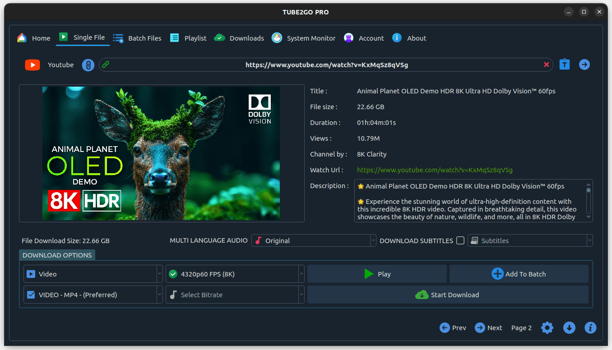
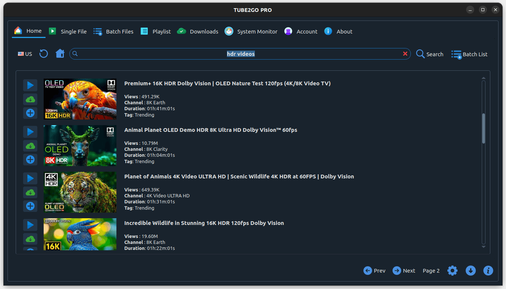
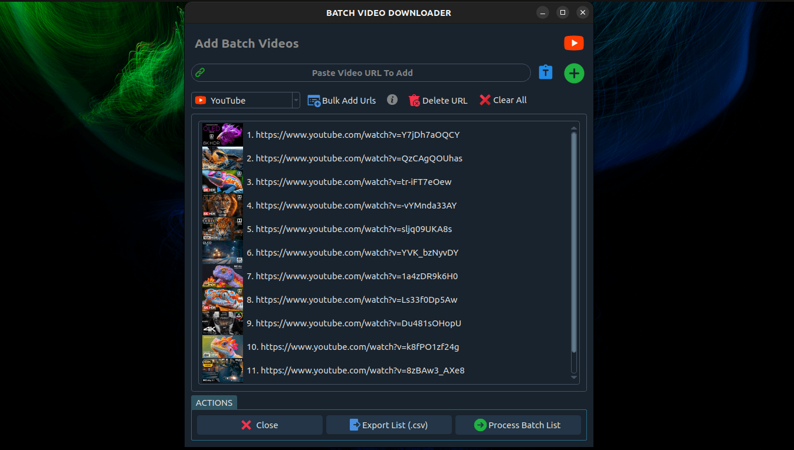
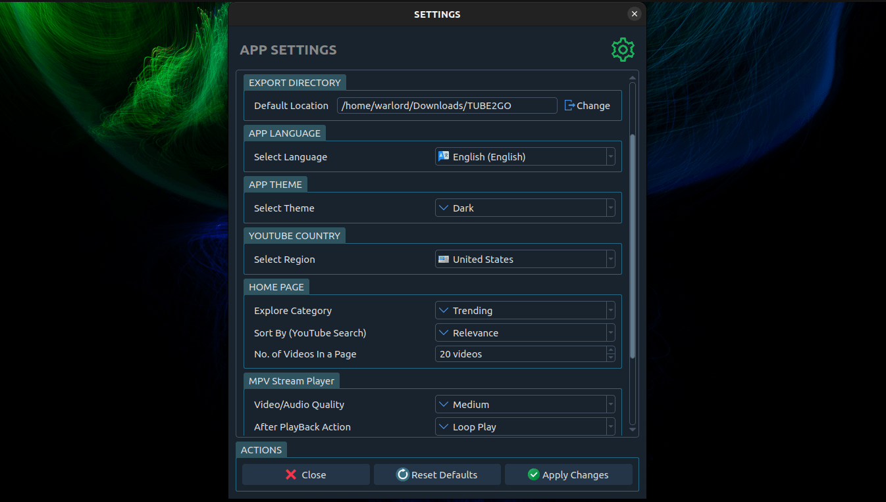
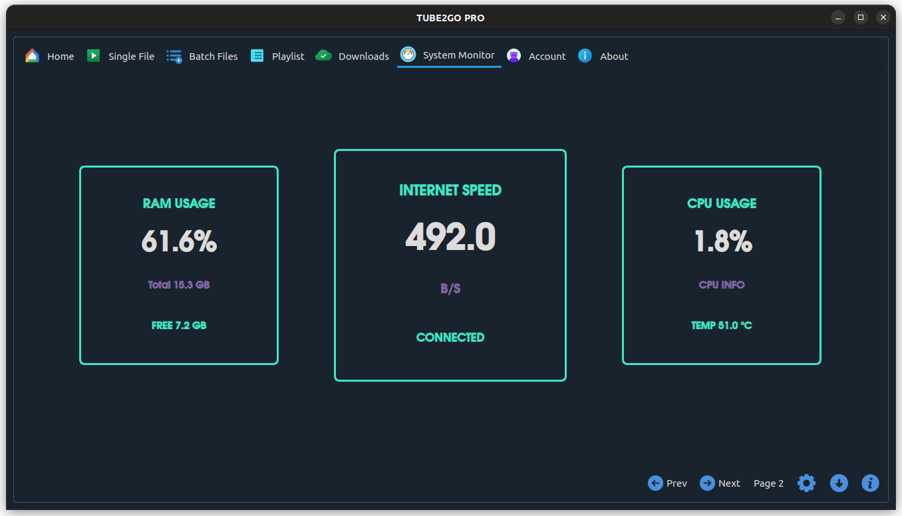

# TUBE2GO: one-click YouTube downloader for Linux and Windows

TUBE2GO is a desktop YouTube downloader for Linux and Windows. It saves videos, playlists and music in HD or as MP3 in one click, with subtitles, dubbed audio tracks and batch queues. A built-in system monitor shows live network speed, CPU and memory while a long download runs. The interface comes in 35+ languages.

<p align="center">
  
</p>

<p align="center">
  <a href="https://flathub.org/apps/details/com.warlordsoftwares.tube2go"></a>
  <a href="https://snapcraft.io/tube2go"></a>
  <a href="https://github.com/rishabh3354/TUBE2GO/releases/latest"></a>
</p>

<p align="center">
  
  
  
  
</p>

> Installed 100,000+ times on Flathub.

## Contents

- [Download and install](#download-and-install)
- [Features](#features)
- [What you can download](#what-you-can-download)
- [Screenshots](#screenshots)
- [Which downloader should I use?](#which-downloader-should-i-use)
- [System requirements](#system-requirements)
- [FAQ](#faq)
- [Responsible use](#responsible-use)
- [More apps](#more-apps-by-warlord-softwares)

## Download and install

<p align="center">
  <a href="https://snapcraft.io/tube2go"></a>&nbsp;
  <a href="https://flathub.org/apps/details/com.warlordsoftwares.tube2go"></a>&nbsp;
  <a href="https://github.com/rishabh3354/TUBE2GO/releases/latest"></a>&nbsp;
  <a href="https://github.com/rishabh3354/TUBE2GO/releases/latest"></a>
</p>

### Linux: Snap

```bash
sudo snap install tube2go
```

### Linux: Flatpak

```bash
flatpak install flathub com.warlordsoftwares.tube2go
```

### Linux: AppImage (any distribution)

Download the latest `.AppImage` from the [releases page](https://github.com/rishabh3354/TUBE2GO/releases/latest), then:

```bash
chmod +x tube2go-x86_64.AppImage
./tube2go-x86_64.AppImage
```

### Windows

Download the Windows installer from the [releases page](https://github.com/rishabh3354/TUBE2GO/releases/latest) and run it. It needs 64-bit Windows 10 or 11.

## Features

- Paste a link, pick MP4, WEBM or MKV, and download.
- Queue a whole YouTube playlist at once.
- Save YouTube audio as high-bitrate MP3 for offline listening.
- The built-in system monitor shows RAM usage, CPU load and temperature, and network speed, so you can see what a long queue is costing your machine.
- Queue many videos and let them download one after another.
- Pick the dubbed audio track you want instead of the default one.
- Save subtitle and closed-caption tracks next to the video.
- Search YouTube inside the app and queue videos, with results for your region.
- Preview a video in the app, without ads, before you save it.
- Download from Facebook, Instagram, TikTok, X (Twitter), Rumble and more.
- The interface is translated into 35+ languages.
- No ads, no trackers, no bundled installers.

## What you can download

| Task | Result |
|---|---|
| Download a YouTube video | MP4 or WEBM at your chosen quality |
| Download a YouTube playlist | Every video queued automatically |
| Convert YouTube to MP3 | Audio only, at high bitrate |
| Download YouTube music | Audio tracks saved for offline listening |
| Download with subtitles | Closed captions saved with the video |
| Download a dubbed audio track | Pick from the other language tracks |
| Batch download many links | Paste a list and let the queue run |
| Watch resource usage | Live RAM, CPU and network speed while downloading |

## Screenshots

| Video download | In-app YouTube search |
|---|---|
|  |  |

| Batch queue | Settings |
|---|---|
|  |  |

The built-in system monitor shows RAM usage, internet speed, CPU load and temperature while your queue runs:



## Which downloader should I use?

Three Warlord Softwares apps download video, and each one aims at something different:

| If you want... | Use |
|---|---|
| A simple one-click downloader with resource monitoring | **TUBE2GO** (this app) |
| The highest resolution (4K and 8K) and full playlist support | **[4KTUBE](https://github.com/rishabh3354/4KTUBE-MEDIA-DOWNLOADER)** |
| The widest site coverage, 1400+ sites beyond YouTube | **[DL-YouTube](https://github.com/rishabh3354/YOUTUBE-DL-PRO)** |

## System requirements

| | Minimum |
|---|---|
| Linux | Ubuntu 20.04+, Debian 11+, Fedora 36+, Arch, or any distro running Flatpak / Snap / AppImage |
| Windows | Windows 10 or Windows 11, 64-bit |
| Architecture | x86_64 |
| RAM | 4 GB |

## FAQ

### Is TUBE2GO free?

TUBE2GO is free to download and use. A one-time Pro upgrade removes the limits and unlocks every feature. There is no subscription.

### Does TUBE2GO work on Linux?

Yes. Install it from Flathub, the Snap Store, or as a portable AppImage on Ubuntu, Debian, Fedora, Arch, Linux Mint and Pop!\_OS. There is a Windows build too.

### How do I download a YouTube video as MP3?

Paste the link, switch the output to audio, choose MP3, and download. Only the audio track is saved.

### Can it download a whole playlist?

Yes. Paste a playlist URL and every video in it is queued for download.

### What is the system monitor for?

A long download queue can fill your connection and heat up the machine. The System Monitor tab shows RAM usage, CPU load and temperature, and network speed, so you can see what the queue is costing you without leaving the app.

### Does it download subtitles?

Yes. It can save closed captions and subtitle tracks next to the video.

### Is TUBE2GO open source?

No. TUBE2GO is a proprietary desktop application. This repository holds the releases, packaging metadata and issue tracker. The application source is not here.

## Responsible use

Use TUBE2GO to save content you have the right to save: your own uploads, Creative Commons material, public-domain video, and content you have permission to keep offline. Please respect copyright and the terms of service of the sites you download from.

## More apps by Warlord Softwares

Other apps by Warlord Softwares are listed on [warlordsoftwares.com](https://warlordsoftwares.com/).

## Links

- Flathub: [com.warlordsoftwares.tube2go](https://flathub.org/apps/details/com.warlordsoftwares.tube2go)
- Snap Store: [snapcraft.io/tube2go](https://snapcraft.io/tube2go)
- Website: [warlordsoftwares.com](https://warlordsoftwares.com/)
- Issues: [github.com/rishabh3354/TUBE2GO/issues](https://github.com/rishabh3354/TUBE2GO/issues)

## License

TUBE2GO is proprietary software. © 2024–2026 Rishabh Bhardwaj / Warlord Softwares. See [LICENSE](LICENSE).
